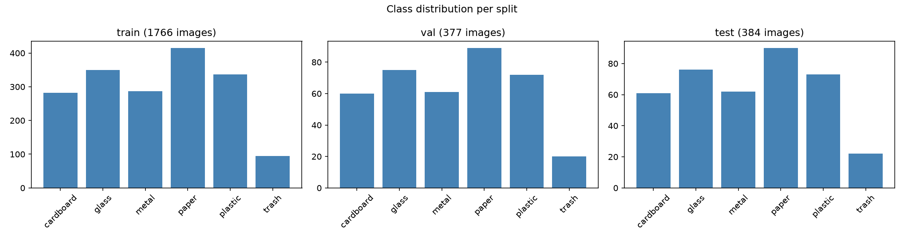
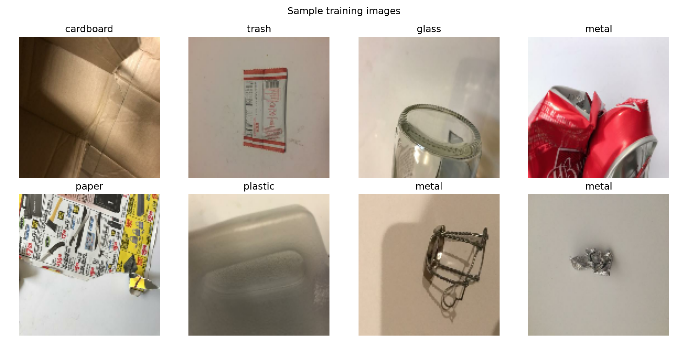
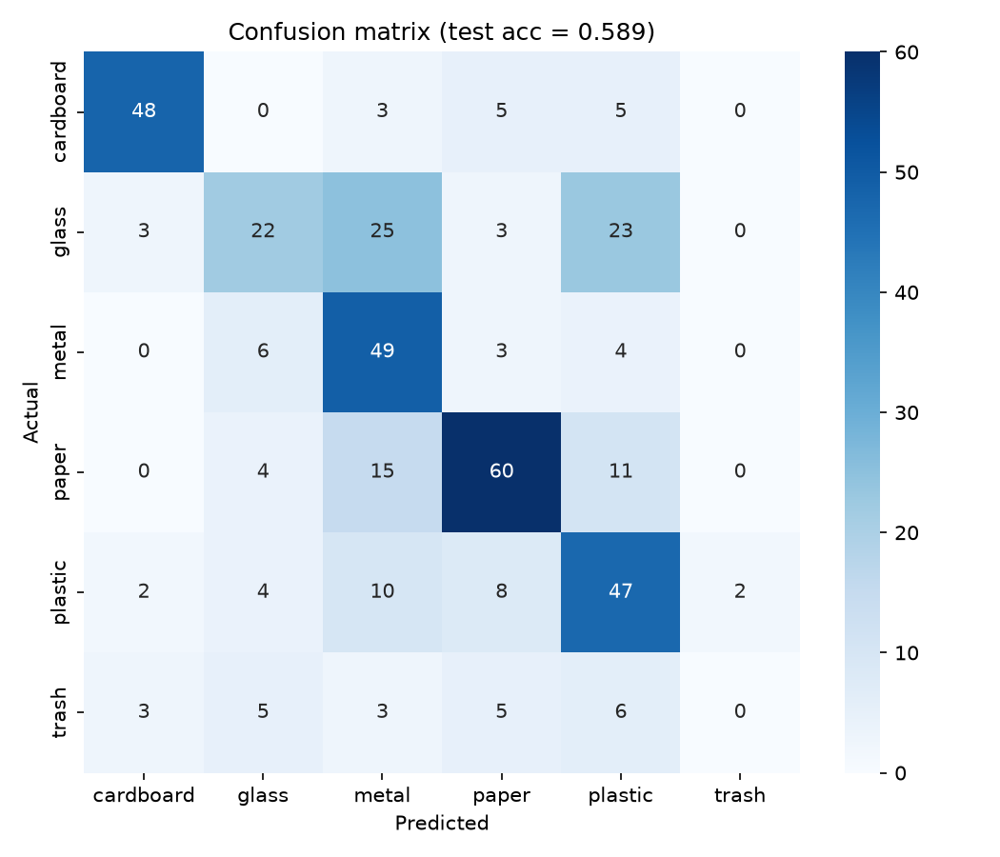
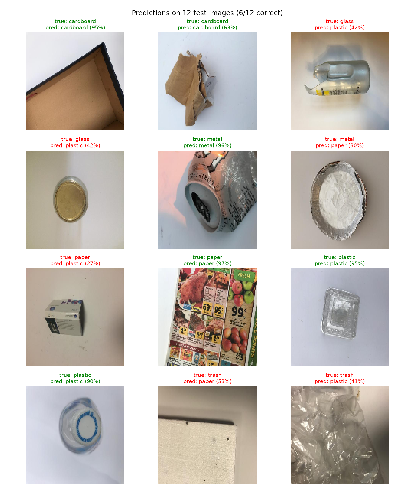

# Waste Classification using CNN

A Convolutional Neural Network (CNN) that classifies images of waste into
**six categories** — cardboard, glass, metal, paper, plastic, trash — built
with TensorFlow/Keras, plus a Gradio web app that accepts **image and video**
uploads (HCCDA-AI course project).

## Results

Test accuracy **58.9%** · F1 (macro) **0.50** · F1 (weighted) **0.57**
(from-scratch CNN trained on CPU; published from-scratch baselines on this
dataset score ~58–63%)

| cardboard | glass | metal | paper | plastic | trash |
|---|---|---|---|---|---|
| F1 0.82 | F1 0.38 | F1 0.59 | F1 0.69 | F1 0.56 | F1 0.00 |

`trash` is never predicted — only 137 of 2,527 dataset images belong to that
class (extreme imbalance). Glass is frequently confused with metal/plastic
(transparent items on white background).

## Visualizations

**Class distribution per split (stratified 70/15/15):**



**Sample training images:**



**Confusion matrix on the test set:**



**Predictions on unseen test images** (green = correct, red = wrong):



## Get the dataset

The dataset is **not** included in this repository. Download it and place it
under `data/raw/` so that the six class folders sit directly inside it:

```
data/raw/cardboard/   data/raw/glass/     data/raw/metal/
data/raw/paper/       data/raw/plastic/   data/raw/trash/
```

Either option works — it is the same dataset:

1. **Kaggle:** [Garbage Classification (TrashNet)](https://www.kaggle.com/datasets/asdasdasasdas/garbage-classification)
   — download and unzip (~2,500 images, 512×384, 6 classes).
2. **Direct mirror (no Kaggle account needed):**
   ```bash
   cd data
   curl -L -o dataset-resized.zip \
     https://raw.githubusercontent.com/garythung/trashnet/master/data/dataset-resized.zip
   unzip dataset-resized.zip && mv dataset-resized raw && rm dataset-resized.zip
   ```

## Setup

```bash
python -m venv .venv && source .venv/bin/activate   # Python 3.12 recommended
pip install -r requirements.txt
```

## Run the full pipeline

```bash
python src/make_splits.py            # stratified 70/15/15 train/val/test split
python src/explore.py                # EDA figures (class counts, sample grid)
python src/train.py --batch-size 32 --epochs 40   # trains and saves outputs/models/waste_cnn.keras
python src/evaluate.py               # test accuracy, F1, confusion matrix
python src/predictions_figure.py     # predictions grid on test images
python app.py                        # Gradio app -> http://localhost:7860
```

Anyone who runs the pipeline reproduces the model automatically — it is not
committed to the repo.

## The Gradio app

- **Image tab:** upload a waste photo → predicted category + confidence
- **Video tab:** upload a video → ~1 frame/second is sampled, classified and
  annotated; the processed video is re-encoded to **H.264** so it plays in all
  browsers

## Model architecture

- Input: 128×128 RGB, rescaled to [0, 1]
- 3 blocks of [Conv2D(3×3) + BatchNorm + ReLU] × 2 + MaxPool (32 → 64 → 128 filters)
- GlobalAveragePooling → Dense(128) + Dropout(0.5) → Softmax(6)
- Augmentation: random flip, ±10% rotation, ±10% zoom
- Adam(1e-3), sparse categorical cross-entropy
- EarlyStopping (patience 6, restore best weights) + ModelCheckpoint (best val accuracy)

## Project structure

```
waste_classification_cnn/
├── data/            # empty — put the downloaded dataset in data/raw/ (see above)
├── src/
│   ├── common.py             # shared paths & constants
│   ├── make_splits.py        # stratified train/val/test split
│   ├── explore.py            # EDA figures
│   ├── train.py              # CNN architecture, training, learning curves
│   ├── evaluate.py           # accuracy, F1, confusion matrix on test set
│   ├── predictions_figure.py # predictions grid on test images
│   └── predict_utils.py      # shared inference helpers
├── outputs/
│   ├── figures/    # all plots shown in this README
│   ├── metrics/    # training history, test metrics, classification report
│   └── models/     # trained .keras model (generated, not committed)
├── app.py          # Gradio web app (image + video tabs)
└── requirements.txt
```
